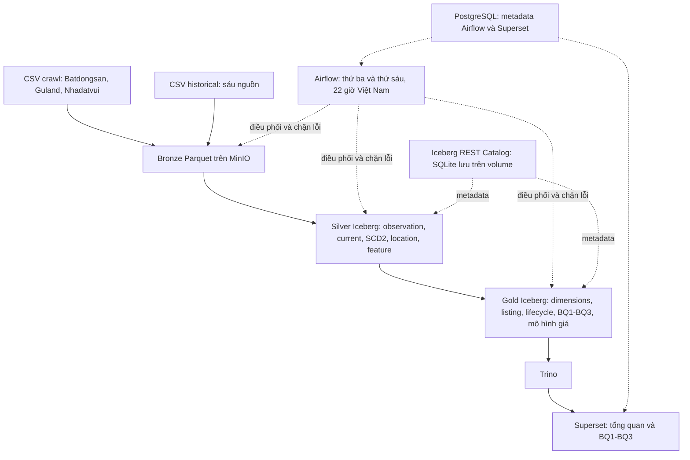

# Kiến trúc pipeline đang sử dụng



Hadoop/HDFS/YARN, FastAPI và web-ui thuộc các profile thử nghiệm, ngoài phạm vi
pipeline trên. Không cần bật chúng để chạy hoặc bảo vệ các kết quả hiện tại.
Các volume cũ được giữ nguyên; không cần xóa dữ liệu khi đổi chế độ vận hành.

## Cửa sổ vận hành

Catalog SQLite hiện chỉ được kiểm chứng theo chế độ một cửa sổ ghi Spark,
sau đó một cửa sổ truy vấn Trino/Superset. Không tuyên bố hỗ trợ đọc/ghi đồng thời.

```powershell
# Chặn chuyển chế độ nếu Spark hoặc DAG vẫn còn hoạt động.
python -m src.orchestration.environment write
# Chạy pipeline, chờ verify xong.
python -m src.orchestration.environment read
```

`listing_history` cập nhật SCD2 bằng MERGE, partition theo `snapshot_date`.
Các bảng Core và Gold còn lại vẫn rebuild. `current` là bản mới nhất đã quan
sát; vắng hai batch không có nghĩa là đã bán. Ngày thiếu của từng nguồn được
ghi trong `config/source_gaps.json` và `docs/validation/crawl_inventory.json`.

## Tái lập và bản chốt

`scripts/validate_defense.ps1` chạy toàn bộ suite, lưu log riêng trong
`outputs/defense/<run_id>/`, kiểm tra đủ 30 bảng qua hai rebuild và xuất
`docs/validation/defense_verification.json`. File này gắn kết quả với checksum
code/config, toàn bộ input và các JSON minh chứng của đúng lần chạy.

Tag `v1.0-bao-ve` chỉ được tạo khi suite PASS, code/input/minh chứng không đổi,
working tree sạch và CI xanh trên chính commit được tag. Nếu bổ sung dữ liệu
sau đó, chạy lại suite và tạo bản phát hành tiếp theo; không di chuyển tag cũ.
