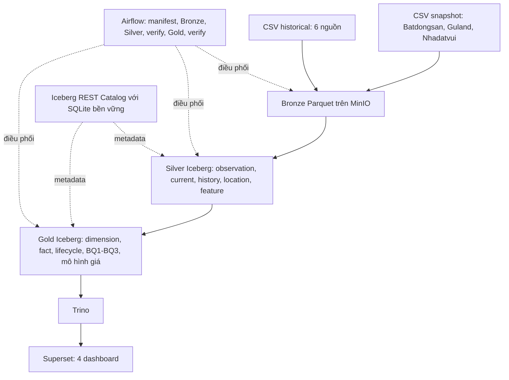

# Kiểm chứng pipeline và chuẩn bị bản bảo vệ

## Kiến trúc đang vận hành



PostgreSQL lưu metadata của Airflow và Superset; dữ liệu nghiệp vụ nằm trên
MinIO. Hadoop/YARN, FastAPI và web-ui thuộc các profile thử nghiệm `hadoop` và
`application`, ngoài phạm vi pipeline bảo vệ. Không cần bật các dịch vụ này.
Không dùng profile `full` vì sẽ khởi động đồng thời writer và query engine.

Catalog SQLite hiện yêu cầu tách cửa sổ ghi Spark và cửa sổ đọc Trino/Superset.
Airflow và runner Spark thủ công đều chặn ghi khi Trino đang hoạt động. Đây
không phải kiểm chứng đọc/ghi đồng thời hoặc catalog nhiều writer.

## Các bước kiểm chứng

1. Chọn ngày batch thực sự có đủ ba CSV, kiểm tra manifest và checksum.
   Không đổi ngày dữ liệu cũ và không tự tái tạo một batch lịch sử bị thiếu.
2. Dừng query/dashboard; khởi động dịch vụ core và orchestration.
3. Chạy DAG đủ 24 task, gồm mô hình giá; xuất trạng thái và thời gian từng task.
4. Rebuild Silver/Gold hai lần từ cùng Bronze, history ở chế độ `rebuild`.
   Fingerprint phải phủ đủ 30 bảng, so số dòng, khóa grain, schema và SHA256
   của toàn bộ multiset row hash. Chỉ bỏ cột thời điểm build.
   Quarantine giữ đủ các dòng raw bị loại, kể cả dòng giống hệt nhau; kiểm
   tra đủ số lần xuất hiện bằng multiset hash thay vì ép khóa quarantine duy nhất.
5. Kiểm chứng MERGE/SCD2 so với rebuild, retry, dữ liệu đến muộn; chạy fixture
   lifecycle và demo Iceberg trong namespace sandbox riêng.
6. Sau khi mọi Spark job kết thúc, bật Trino/Superset. Sao lưu dashboard trước
   khi chạy provisioning (script tái tạo các dashboard/dataset do nó quản lý).
   Đối chiếu đủ 30 bảng, 29 chart và bộ lọc tỉnh; refresh nhận xét dashboard
   vì số cặp BQ3 đã thay đổi.
7. Chạy pytest, compileall và kiểm tra diff; lưu kết quả thực tế trong
   `docs/validation/`, log đầy đủ và bản sao kết quả cũ trong `outputs/`.

Lệnh rebuild đầy đủ:

```powershell
docker stop tlcn_superset tlcn_trino
./scripts/check_deterministic_rebuild.ps1
```

Script dừng ngay nếu build, verify hoặc fingerprint lỗi. Hai file fingerprint
nằm tại `outputs/determinism/run1.json` và `run2.json`; kết quả đối chiếu tại
`docs/validation/deterministic_rebuild.json`.

## Điều kiện chốt

- Manifest và Bronze audit PASS; dữ liệu đầu vào không đổi qua hai rebuild.
- Airflow 24/24 SUCCESS; Silver 30/30 và Gold 108/108 PASS.
- Hai rebuild đủ 30 bảng giống schema, grain, số dòng và nội dung.
- Kiểm chứng SCD2, lifecycle, demo Iceberg và dashboard PASS.
- Unit test và CI trên đúng commit chuẩn bị phát hành đều xanh.
- Có batch mới nhất thực tế của nhóm, review PR và kiểm chứng cuối trước mốc
  đóng băng; khi đó mới tạo tag `v1.0-bao-ve`. Không tạo tag sớm chỉ vì test
  trên batch cũ đã qua.

Mô hình giá hoặc độ chính xác nhãn có thể chưa đạt tiêu chí nghiệp vụ dù
kiểm định kỹ thuật PASS. Ghi riêng các giới hạn nghiệp vụ, không sửa kết quả
hoặc tự gán nhãn để hoàn tất điều kiện vận hành A.
