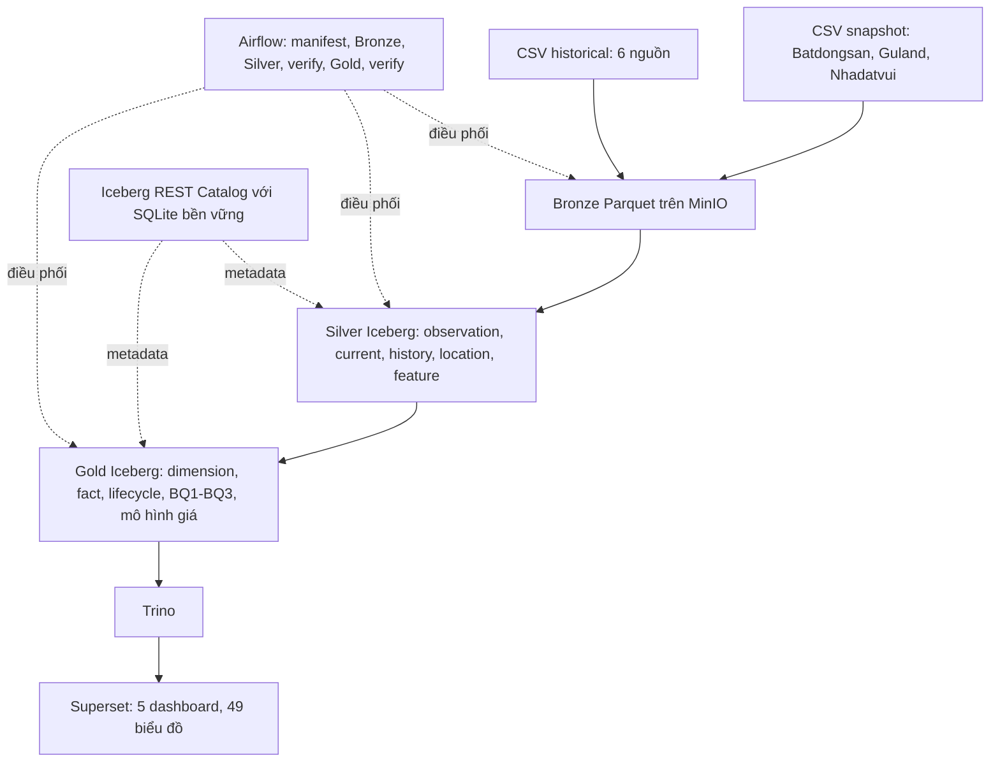

# Kiểm chứng pipeline và chuẩn bị bản bảo vệ

## Kiến trúc đang vận hành

Sơ đồ triển khai và phạm vi dịch vụ: [kiến trúc pipeline](../architecture.md).



PostgreSQL lưu metadata của Airflow và Superset; dữ liệu nghiệp vụ nằm trên
MinIO. Compose chỉ gồm các dịch vụ phục vụ pipeline; không chạy đồng thời cửa sổ ghi Spark và cửa sổ đọc Trino/Superset.

Khi chuyển sang write mode, `src.orchestration.environment` kiểm tra không có
writer/run đang hoạt động, dừng Superset/Trino, rồi mở lại các kết nối của
Iceberg REST trước khi chờ dịch vụ healthy. Lượt chạy ngày 17/11 phát hiện
SQLite read transaction còn giữ trong pool REST sau query window; chỉ dừng
Trino chưa đủ ở trường hợp đó. Khởi động lại REST giữ nguyên catalog volume,
không xóa database hoặc file dữ liệu. Lỗi commit không rõ trạng thái phải
được kiểm tra trước khi chạy lại; không tự purge orphan files của nghiệp vụ.

Client Airflow chỉ retry thêm một lần đối với GET/HEAD trả 403, sau một giây,
để xử lý clock jitter làm JWT `iat` chưa hợp lệ. Server vẫn kiểm tra token;
lỗi phân quyền thực vẫn thất bại. POST/PATCH/DELETE không được retry tự động,
tránh nộp DAG hoặc thay trạng thái nhiều lần.

Catalog SQLite hiện yêu cầu tách cửa sổ ghi Spark và cửa sổ đọc Trino/Superset.
Airflow và runner Spark thủ công đều chặn ghi khi Trino đang hoạt động. Đây
không phải kiểm chứng đọc/ghi đồng thời hoặc catalog nhiều writer.

## Các bước kiểm chứng

1. Chọn ngày batch thực sự có đủ ba CSV, kiểm tra manifest và checksum.
   Không đổi ngày dữ liệu cũ và không tự tái tạo một batch lịch sử bị thiếu.
2. Dừng query/dashboard; khởi động dịch vụ core và orchestration.
3. Chạy DAG đủ 26 task, gồm mô hình giá và các bảng minh chứng BQ; xuất trạng thái và thời gian từng task.
4. Rebuild Silver/Gold hai lần từ cùng Bronze, history ở chế độ `rebuild`.
   Fingerprint phải phủ đủ 38 bảng, so số dòng, khóa grain, schema và SHA256
   của toàn bộ multiset row hash. Chỉ bỏ cột thời điểm build.
   Quarantine giữ đủ các dòng raw bị loại, kể cả dòng giống hệt nhau; kiểm
   tra đủ số lần xuất hiện bằng multiset hash thay vì ép khóa quarantine duy nhất.
5. Kiểm chứng MERGE/SCD2 so với rebuild, retry, dữ liệu đến muộn; chạy fixture
   lifecycle và demo Iceberg trong namespace sandbox riêng.
6. Sau khi mọi Spark job kết thúc, bật Trino/Superset. Sao lưu dashboard trước
   khi chạy provisioning (script tái tạo các dashboard/dataset do nó quản lý).
   Đối chiếu đủ 38 bảng, 49 chart và bộ lọc tỉnh; refresh nhận xét dashboard
   vì số cặp BQ3 đã thay đổi.
7. Chạy pytest, compileall và kiểm tra diff; lưu kết quả thực tế trong
   `docs/validation/`, log đầy đủ và bản sao kết quả cũ trong `outputs/`.

Lệnh rebuild đầy đủ:

```powershell
docker stop tlcn_superset tlcn_trino
./scripts/check_deterministic_rebuild.ps1
```

Script dừng ngay nếu build, verify hoặc fingerprint lỗi. Hai file fingerprint
nằm tại `outputs/determinism/run1.json` và `run2.json`; kết quả đối chiếu tại
`docs/validation/deterministic_rebuild.json`.

## Chạy trọn bộ kiểm chứng

```powershell
./scripts/validate_defense.ps1 -BatchId 20261120
```

Mặc định, mốc "đợt thu đến hạn" tính theo ngày hiện tại. Khi nhóm đã chốt dừng
dữ liệu ở một đợt thu đã qua (ví dụ 20/11) và các đợt đến hạn sau đó không được
nạp, thêm `-AsOf 20261120`. Mốc phải là đợt thu thứ Ba hoặc thứ Sáu đã đến hạn;
nó được ghi vào `baseline.json` và `defense_verification.json`
(`data_freeze_batch`, `due_batch_basis`) và được dùng lại khi gắn tag. Đây là
quyết định đóng băng dữ liệu của nhóm, không thay cho việc thu đợt mới.

Lệnh này dùng đúng batch thật đã có đủ ba nguồn. Suite kiểm tra manifest, chạy
pytest và compileall, thử chặn downstream khi lỗi rồi chạy DAG bình thường đến
SUCCESS để trạng thái run mới nhất xanh; sau đó chạy hai rebuild,
MERGE/SCD2, lifecycle và demo Iceberg; sau đó chuyển sang query/dashboard, sao
lưu và refresh dashboard, đối chiếu Trino, biểu đồ và bộ lọc. Log và bản sao
minh chứng nằm trong `outputs/defense/<run_id>/`; dữ liệu raw không bị ghi đè.

Không thêm, xóa hoặc sửa CSV trong lúc suite chạy. Bronze kiểm tra toàn bộ tập
input trước ghi và kiểm tra lại cuối job; thay đổi đầu vào làm suite dừng.
Bronze commit theo từng batch; batch đã ghi thành công được giữ để retry,
không tuyên bố giao dịch nguyên tử cho toàn pipeline.

Nhật ký crawl được sinh từ file thật và manifest, gồm các batch thiếu đã khai
báo. Guland 20/10/2026 thiếu do lỗi website; không tạo batch giả để lấp lịch.

Sau khi commit/push bản đã kiểm chứng và CI xanh trên đúng commit:

```powershell
python -m src.quality.tag_defense --tag v1.1.2-bao-ve --push
```

Lệnh tag từ chối nếu code, input hoặc file minh chứng thay đổi sau test, hoặc
CI chỉ thuộc một commit khác. Tag đã tồn tại ở commit khác sẽ không bị ghi đè.

Checksum input CSV so sánh từng byte. JSON minh chứng mới ghi rõ quy tắc chuẩn
hóa LF/CRLF để bản checkout Windows và Linux kiểm chứng cùng nội dung; mọi thay
đổi nội dung khác vẫn làm tag bị từ chối. Báo cáo mô hình giá và minh chứng BQ
cũng được đóng checksum trong bộ nghiệm thu. Scheduler được pause trước khi
mở cửa sổ Trino/Superset.

## Điều kiện chốt

Kiểm tra bổ sung: host/Spark/Airflow có cùng identity, hash một/bốn worker giống nhau trên toàn bộ byte, historical CSV khớp raw-row multiset trong Bronze, publication chặn đọc khi build lỗi. Báo cáo mô hình mới là candidate khi chưa được chủ cấu hình áp dụng; nghiệm thu kỹ thuật giữ phạm vi riêng với nhãn/BQ.

- Manifest và Bronze audit PASS; dữ liệu đầu vào không đổi qua hai rebuild.
- Airflow 26/26 SUCCESS; Silver 30/30 và toàn bộ kiểm định Gold hiện hành PASS.
- Hai rebuild đủ 38 bảng giống schema, grain, số dòng và nội dung.
- Kiểm chứng SCD2, lifecycle, demo Iceberg và dashboard PASS.
- Unit test và CI trên đúng commit chuẩn bị phát hành đều xanh.
- Có batch mới nhất thực tế của nhóm, review PR và kiểm chứng cuối trước mốc
  đóng băng; khi đó mới tạo tag version mới. Không tạo tag sớm chỉ vì test
  trên batch cũ đã qua.

Mô hình giá hoặc độ chính xác nhãn có thể chưa đạt tiêu chí nghiệp vụ dù
kiểm định kỹ thuật PASS. Ghi riêng các giới hạn nghiệp vụ, không sửa kết quả
hoặc tự gán nhãn để hoàn tất điều kiện vận hành A.

Áp dụng [quy trình công bố và phục hồi](publication_and_recovery.md). Tag ví dụ chỉ là ứng viên; phải có CI xanh của đúng commit trước khi phát hành.
